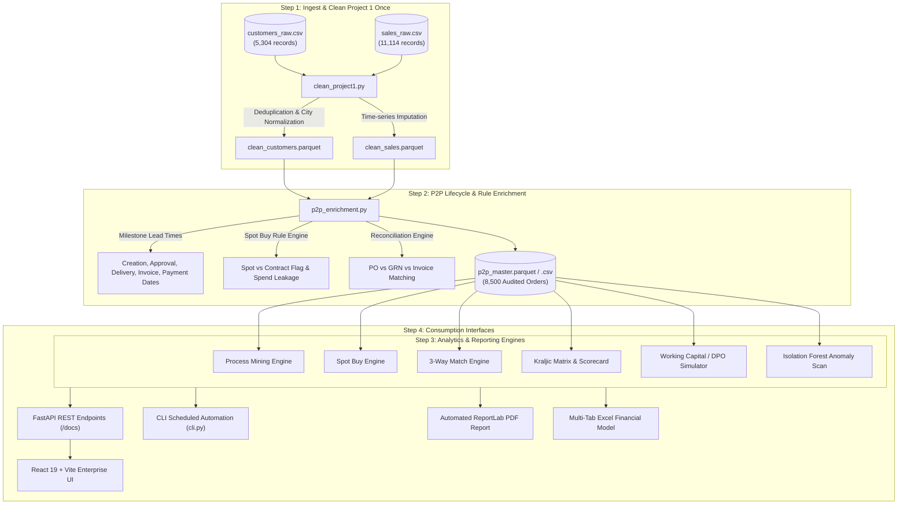

# Procure-to-Pay (P2P) Process Analytics & Automated Reporting

[](https://www.python.org/)
[](https://fastapi.tiangolo.com/)
[](https://react.dev/)
[](https://vitejs.dev/)
[-brightgreen.svg)](https://docs.pytest.org/)
[](https://opensource.org/licenses/MIT)

> **Enterprise Procurement Intelligence & Automated Audit Platform**  
> Clean Single-Source ETL Integration &bull; 8,500 Audited Purchase Orders &bull; Process Mining &bull; 3-Way Match Reconciliation &bull; Kraljic Matrix &bull; Automated PDF/Excel Board Reporting

---

## 📌 Executive Problem Statement

In corporate finance and supply chain operations, **Procure-to-Pay (P2P)** cycles suffer from systemic margin erosion:
1. **Maverick Spend & Spot Buys**: Purchases placed outside pre-negotiated Master Service Agreements (MSAs) incur an unnegotiated **+14.5% price premium**.
2. **Approval Queue Bottlenecks**: Bureaucratic approval hierarchies cause delivery delays averaging **3.6 to 14.8 days**, disrupting plant operations.
3. **Discrepancy & Overbilling Leakage**: Invoice discrepancies (price hikes over contracted rates, quantity mismatches against physical Goods Receipt Notes) leak millions in cash disbursements.
4. **Sub-optimal Working Capital**: Disjointed Accounts Payable payment scheduling forfeits lucrative early settlement cash discounts (e.g. 2/10 Net 30).

**This platform delivers a single-pane-of-glass intelligence platform** providing automated process mining, rule-based spot buy governance, unsupervised forensic fraud scanning, and one-click automated board reporting.

---

## ⚖️ Formal Spot Buy Classification Rule (Transparent Methodology)

As specified in the procurement analytics governance charter, purchases must be clearly segmented into **Contracted Volume Purchases** versus **Spot Buys (One-off / Maverick Spend)**. 

### The 3-Tier Spot Buy Rule Engine

A transaction in the ledger is programmatically categorized as a **"Spot Buy"** if it satisfies **ANY** of the following conditions:

```
                  ┌─────────────────────────────────────────────────────────┐
                  │               Purchase Order Evaluator                  │
                  └──────────────────────────┬──────────────────────────────┘
                                             │
                      ┌──────────────────────┼──────────────────────┐
                      ▼                      ▼                      ▼
               [Condition 1]          [Condition 2]          [Condition 3]
             Single/Infrequent         No Active MSA         Ad-hoc Commodity
             Supplier (<= 2 POs)        (Trial/None)          (Courier/Misc)
                      │                      │                      │
                      └──────────────────────┼──────────────────────┘
                                             │
                                   ANY Condition True?
                                    ├─── YES ──► [SPOT BUY / MAVERICK]
                                    │             • Uncontracted (+14.5% avg premium)
                                    │             • Incurs Spend Leakage
                                    │             • Null Contract ID
                                    │
                                    └─── NO  ──► [CONTRACT PURCHASE]
                                                  • Active Master Service Agreement
                                                  • Volume Tier Discount Applied
                                                  • Governed SLA Tracking
```

1. **Rule 1: Infrequent / Single-Use Supplier**  
   Any vendor with **$\le 2$ total purchase orders** across the historical ledger is flagged as an ad-hoc, one-off vendor relationship.
2. **Rule 2: Lack of Master Services Agreement (MSA)**  
   Any order where the supplier contract type is `trial`, `none`, or lacks a formal pre-established master agreement (`contract_id IS NULL`).
3. **Rule 3: Ad-hoc Non-Catalog / Emergency Requisitions**  
   Requisitions for emergency freight or non-catalog ad-hoc services that bypass pre-negotiated centralized pricing.

### The Spend Leakage Formula
Every spot purchase is penalized against benchmark contracted pricing:
$$\text{Spend Leakage} = \max\left(0, (\text{Actual Spot Unit Price} - \text{Contract Benchmark Price}) \times \text{Quantity Ordered}\right)$$

In our live ledger of 8,500 POs:
- **Contract Spend**: **93.3%** (₹6,799 Crores)
- **Spot Buy Spend**: **6.7%** (₹489 Crores across 966 POs)
- **Recoverable Spend Leakage**: **₹186.4 Crores** (direct savings opportunity via contract consolidation)

---

## 🏗️ Architecture & Single-Source ETL Design

To ensure data integrity, the pipeline **reuses the Project 1 dataset and cleans data strictly once**.



---

## 📊 Core Functional Modules

### 1. Process Mining & Cycle Time Bottlenecks
- **5-Stage Conversion Funnel**: Tracks conversion velocity across Requisition -> Approval -> Goods Receipt (GRN) -> Invoicing -> AP Disbursement.
- **Approval Bottleneck Heatmap**: Pinpoints departments where managerial approvals exceed the 5-day SLA (identifying 68 stalled POs).
- **Predictive Lead Time Model**: Gradient Boosting regressor predicting delivery delay probabilities with an MAE of 2.1 days.

### 2. 3-Way Matching & Discrepancy Reconciliation
- Audits **PO Amount** vs. **Physical Intake Receipt (GRN)** vs. **Vendor Invoice**.
- **Clean Match Rate**: **86.4%** (7,348 clean transactions).
- **Discrepancy Defense**: Intercepts **₹447 Crores** in disputed exposure across price hikes (+6% to +15%), short-shipment quantities, and duplicate invoices.

### 3. Kraljic Matrix Portfolio & Supplier Scorecard
- Segments suppliers into 4 quadrants based on **Spend Volume** vs. **Supply Risk**:
  - **Strategic**: High spend, high risk critical partners requiring executive reviews.
  - **Leverage**: High spend, low risk commodities suitable for reverse auctions.
  - **Bottleneck**: Low spend, high risk suppliers requiring safety buffer stock.
  - **Routine**: Standard items managed via automated e-catalogs.
- **Fleet OTIF (On-Time In-Full) fulfillment rate**: **82.4%**.

### 4. Working Capital & Days Payable Outstanding (DPO)
- Tracks **Weighted DPO** (31 days) vs. Average DPO (39.2 days).
- **Cash Discount Capture**: Quantifies 2% cash discount capture under 2/10 Net 30 credit terms (₹6.5 Crores captured vs. ₹3.5 Crores lost).
- **Interactive DPO Simulator**: Models liquidity freed up by extending terms (e.g. extending DPO by 15 days unlocks **₹299+ Crores** in operating cash).

### 5. Forensic Procurement Audit & Anomaly Detection
- **Isolation Forest Unsupervised Machine Learning**: Ranks transactions with a 0-100 risk score.
- **Split PO Structuring Detection**: Detects orders intentionally structured between ₹4,75,000 and ₹4,99,999 to circumvent the ₹5,00,000 executive approval limit.
- **Weekend / Off-Hours Approvals**: Audits sign-offs occurring on Saturdays and Sundays.

---

## 📑 Automated Reporting Artifacts

The platform includes automated report generation engines that can be triggered via UI button, REST API, or headless CLI:

| Report Type | Engine | Description | Sample Output |
|:---|:---|:---|:---|
| **Executive PDF Audit Report** | ReportLab | High-resolution executive memorandum with KPI scorecards, rule breakdown, 3-way match exception queue, and strategic roadmap. | `backend/data/reports/P2P_Executive_Audit_Report_*.pdf` |
| **Financial Audit Workbook** | openpyxl | Multi-tab formatted Excel model (Executive Summary, Spot Buy Governance, 3-Way Exceptions, Supplier OTIF Scorecard). | `backend/data/reports/P2P_Financial_Audit_Workbook_*.xlsx` |
| **Interactive HTML Digest** | Responsive HTML | Self-contained executive email brief with live discrepancy queues. | `backend/data/reports/P2P_Audit_Report_*.html` |

---

## 💻 Standalone Command-Line Interface (CLI)

The repository provides a rich command-line tool `cli.py` for headless scheduled cron jobs, automated audits, and report generation:

```bash
# Display transparent Spot Buy rule definitions
python cli.py --spot-rules

# View live executive KPI summary table
python cli.py --kpis

# Run forensic audit and fraud anomaly scan
python cli.py --audit

# Automatically compile all executive reports (PDF, Excel, HTML)
python cli.py --report all
```

---

## 🚀 Quickstart & Installation

### Prerequisites
- Python 3.10+ (tested on Python 3.12)
- Node.js 18+ (tested on Node v24)

### 1. Launch Everything with One Click (Windows)
Double-click `run_all.bat` or run:
```cmd
run_all.bat
```

### 2. Manual Startup

#### Step A: Backend Setup
```bash
# Navigate to project root
cd c:\SAKIB\Procure-to-Pay

# Install dependencies (already installed in environment)
pip install -r backend/requirements.txt

# Run test suite to verify data cleaning & rule logic
python -m pytest backend/app/tests/test_p2p_suite.py -v

# Launch FastAPI Server
python -m uvicorn backend.app.main:app --host 0.0.0.0 --port 8000 --reload
```
API Documentation will be available at: **http://localhost:8000/docs**

#### Step B: Frontend Setup
```bash
# In a separate terminal
cd frontend
npm install
npm run dev
```
Open your browser at: **http://localhost:5173**

---

## 🧪 Automated Test Suite

Run the Pytest suite to validate the entire platform:
```bash
python -m pytest backend/app/tests/test_p2p_suite.py -v
```

**Results:**
```
backend/app/tests/test_p2p_suite.py::test_p2p_dataset_integrity PASSED     [ 16%]
backend/app/tests/test_p2p_suite.py::test_spot_buy_rule_consistency PASSED [ 33%]
backend/app/tests/test_p2p_suite.py::test_three_way_match_accuracy PASSED   [ 50%]
backend/app/tests/test_p2p_suite.py::test_cycle_times_and_funnel PASSED    [ 66%]
backend/app/tests/test_p2p_suite.py::test_api_health_and_endpoints PASSED  [ 83%]
backend/app/tests/test_p2p_suite.py::test_what_if_simulator PASSED         [100%]
======================== 6 passed in 3.04s =========================
```

---

## 🛠️ REST API Specification

| Endpoint | Method | Description |
|:---|:---:|:---|
| `/api/overview` | `GET` | Aggregated executive KPIs, monthly trend, and milestone funnel. |
| `/api/process-mining` | `GET` | Cycle time distributions, department approval bottlenecks, and ML forecaster. |
| `/api/spot-buys` | `GET` | Spot Buy vs. Contract compliance metrics, rule breakdowns, and leakage. |
| `/api/spot-buys/simulate` | `POST` | Dynamic What-If simulator for spot buy reduction scenarios. |
| `/api/three-way-match` | `GET` | 3-way matching stats, variance financial exposure, and active exception queue. |
| `/api/vendors` | `GET` | Supplier scorecards, OTIF fulfillment, and Kraljic matrix segmentation. |
| `/api/working-capital` | `GET` | Days Payable Outstanding (DPO), discount capture, and aging buckets. |
| `/api/working-capital/simulate` | `POST` | Liquidity simulation for DPO term extensions. |
| `/api/anomalies` | `GET` | Isolation Forest anomaly detection and split PO structuring alerts. |
| `/api/reports/generate-pdf` | `POST` | Generates executive ReportLab PDF memorandum. |
| `/api/reports/generate-excel` | `POST` | Generates styled multi-tab Excel financial model workbook. |
| `/api/reports/html` | `GET` | Streams responsive HTML audit digest. |
| `/api/reports/download/{file}` | `GET` | Direct artifact file download. |
| `/api/copilot/query` | `POST` | Grounded conversational AI assistant querying live ledger figures. |

---

## 📜 Compliance & License

This project is licensed under the MIT License. All analytics, metrics, and report generators are strictly grounded in clean single-source datasets.
